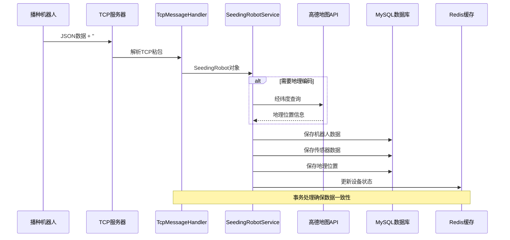
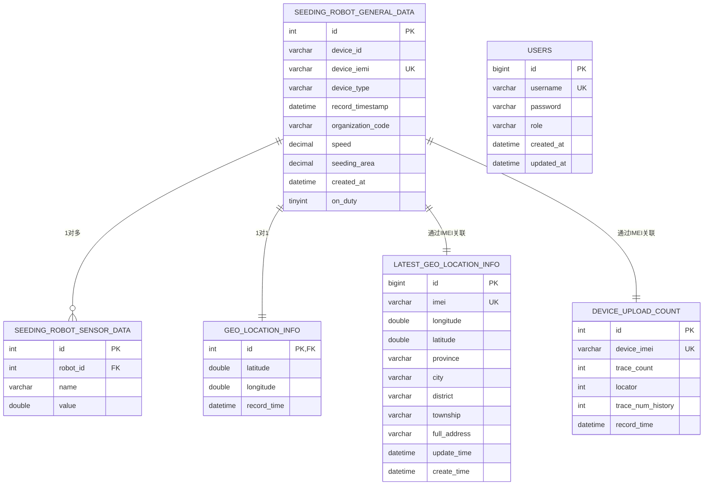
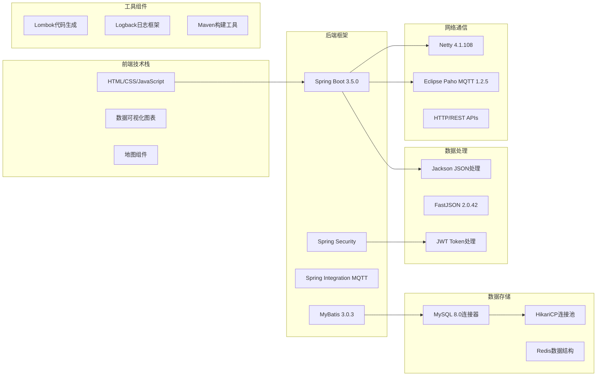
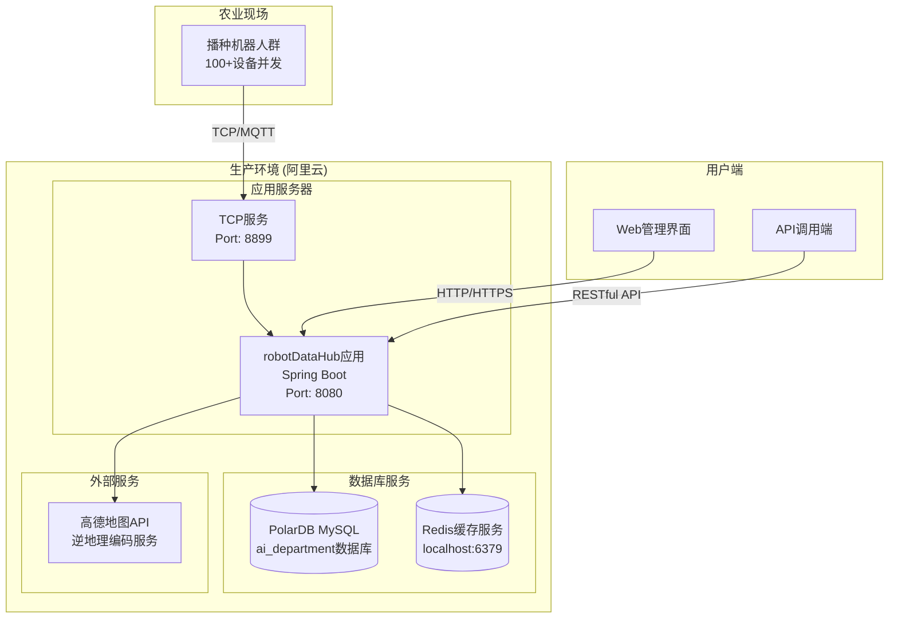

# robotDataHub 系统架构图

## 整体系统架构

```mermaid
graph TB
    subgraph "设备层 (Device Layer)"
        A1[播种机器人1<br/>IEMI: 860123456789012]
        A2[播种机器人2<br/>IEMI: 860123456789013]
        A3[播种机器人N<br/>IEMI: 860123456789xxx]
    end

    subgraph "数据接入层 (Data Access Layer)"
        B1[TCP服务器<br/>Port: 8899<br/>Netty Framework]
        B2[MQTT客户端<br/>Eclipse Paho<br/>QoS: 1]
    end

    subgraph "消息处理层 (Message Processing Layer)"
        C1[TcpMessageHandler<br/>JSON解析 + ###END###分隔符]
        C2[MqttMessageHandler<br/>负载解析处理]
        C3[线程池管理<br/>Worker: 5线程<br/>Acceptor: 1线程]
    end

    subgraph "业务逻辑层 (Business Logic Layer)"
        D1[SeedingRobotService<br/>核心业务逻辑]
        D2[AmapReverseGeocoding<br/>地理位置解析]
        D3[设备状态管理<br/>心跳检测 65s超时]
    end

    subgraph "数据访问层 (Data Access Layer)"
        E1[SeedingRobotDataMapper]
        E2[SensorDataMapper]
        E3[GeographicLocationMapper]
        E4[UserAccountMapper]
    end

    subgraph "数据存储层 (Data Storage Layer)"
        F1[(MySQL 8.0<br/>阿里云PolarDB<br/>ai_department)]
        F2[(Redis Cache<br/>localhost:6379)]
    end

    subgraph "Web服务层 (Web Service Layer)"
        G1[RobotDataController<br/>RESTful APIs]
        G2[LoginController<br/>JWT认证]
        G3[PageController<br/>页面控制]
    end

    subgraph "安全层 (Security Layer)"
        H1[LoginCheckedFilter<br/>JWT Token验证]
        H2[UserContext<br/>用户会话管理]
    end

    subgraph "外部服务 (External Services)"
        I1[高德地图API<br/>逆地理编码服务]
    end

    %% 数据流向
    A1 --> B1
    A2 --> B1
    A3 --> B1
    A1 --> B2
    A2 --> B2
    A3 --> B2

    B1 --> C1
    B2 --> C2
    C1 --> C3
    C2 --> C3
    C3 --> D1

    D1 --> D2
    D1 --> D3
    D2 --> I1

    D1 --> E1
    D1 --> E2
    D1 --> E3

    E1 --> F1
    E2 --> F1
    E3 --> F1
    D3 --> F2

    G1 --> D1
    G2 --> E4
    G3 --> D1

    H1 --> G1
    H1 --> G2
    H2 --> H1

    %% 样式定义
    classDef deviceClass fill:#e1f5fe,stroke:#01579b,stroke-width:2px
    classDef networkClass fill:#f3e5f5,stroke:#4a148c,stroke-width:2px
    classDef processClass fill:#e8f5e8,stroke:#1b5e20,stroke-width:2px
    classDef businessClass fill:#fff3e0,stroke:#e65100,stroke-width:2px
    classDef dataClass fill:#fce4ec,stroke:#880e4f,stroke-width:2px
    classDef storageClass fill:#f1f8e9,stroke:#33691e,stroke-width:2px
    classDef webClass fill:#e0f2f1,stroke:#004d40,stroke-width:2px
    classDef securityClass fill:#ffebee,stroke:#b71c1c,stroke-width:2px
    classDef externalClass fill:#f5f5f5,stroke:#424242,stroke-width:2px

    class A1,A2,A3 deviceClass
    class B1,B2 networkClass  
    class C1,C2,C3 processClass
    class D1,D2,D3 businessClass
    class E1,E2,E3,E4 dataClass
    class F1,F2 storageClass
    class G1,G2,G3 webClass
    class H1,H2 securityClass
    class I1 externalClass
```

## 数据流处理架构



## 数据库关系图



## 技术栈组件图



## 部署架构图


